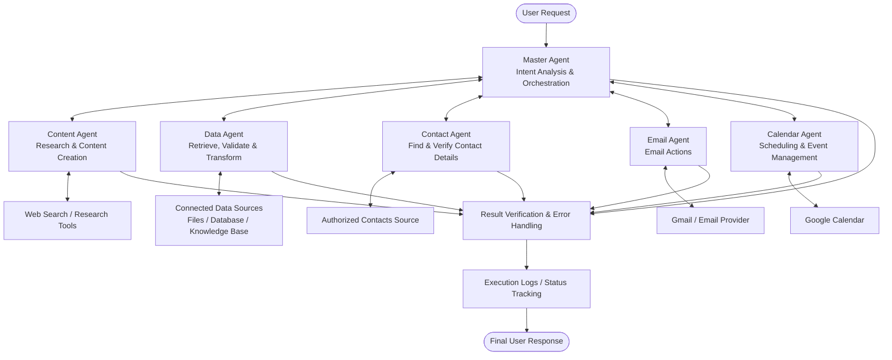

AI Personal Assistant
Premium Multi-Agent Automation Platform
One Master Agent. Five Specialist Agents. One Coordinated Workflow.

Automate content creation, data operations, contact lookup, email communication, and calendar scheduling with an extensible n8n-based AI agent architecture.

  
  
  
  

Developed / Presented by WAQAS SOFTWARE HOUSE
WhatsApp / Contact: +92 343 4487450

🚀 Overview
AI Personal Assistant is a modular, tool-driven automation platform. A Master Agent receives a user's request, determines the work required, and delegates tasks to five specialist agents:
1. Content Agent — researches, writes, and formats content.
2. Data Agent — retrieves, validates, transforms, and organizes data from connected sources.
3. Contact Agent — finds and verifies contact details from authorized sources.
4. Email Agent — performs email actions through Gmail or another connected provider.
5. Calendar Agent — creates, retrieves, updates, and deletes calendar events.
The Master Agent coordinates these agents, passes verified outputs between them, and checks results before reporting completion. It should invoke actual connected tools—not merely describe a plan.
Core principle: Understand the request → route to the right agent → execute → verify → report accurately.

Implementation note: This README describes the target architecture and intended behavior. Actual capabilities depend on the n8n workflows, connected tools, provider permissions, credentials, and model configuration in your deployment.

✨ Key Features
- Intelligent orchestration: Routes each request to the agents and tools required for the task.
- Content creation: Research-backed articles, summaries, email copy, descriptions, and HTML output.
- Data operations: Retrieve, validate, transform, and organize data from configured sources.
- Contact lookup: Find available email addresses and phone numbers without guessing.
- Gmail automation: Send messages, create drafts, reply, and send confirmations where supported.
- Calendar management: Create, retrieve, update, and delete events; manage attendees and event details.
- Cross-agent workflows: Combine content, data, contact, email, and calendar operations in a single request.
- Dynamic date and time: Resolve relative dates and use the configured calendar time zone.
- Verification and recovery: Distinguish success, failure, and partial completion.
- Execution logging: Track workflow status and useful diagnostic metadata.
- Extensible architecture: Add new agents and integrations as the project grows.
🧠 System Architecture

Architecture Responsibilities
Layer	Responsibility
User interface / trigger	Receives a request from chat, form, webhook, or parent workflow
Master Agent	Interprets intent, selects agents, manages dependencies, and coordinates execution
Specialist agents	Perform assigned tasks through their connected tools
Provider integrations	Access authorized Gmail, Google Calendar, contacts, web search, and data sources
Verification layer	Checks tool results, event details, and operation status
Logging layer	Records execution IDs, statuses, timestamps, and useful error metadata
Final response	Summarizes confirmed outcomes and unresolved blockers

🤖 The Five Specialist Agents
1. Content Agent — Research, Write, Create
Purpose: Produce useful, accurate, well-structured content.
- Research topics with available web-search tools when needed.
- Generate blog posts, summaries, descriptions, messages, and requested HTML.
- Use titles, introductions, headings, and clickable sources where appropriate.
- Prepare email body content when requested.
- Avoid invented statistics, quotations, sources, or unsupported claims.
- Return generated content to the Master Agent for the next step.
Example: “Research this topic and prepare a short email summary for my team.”
2. Data Agent — Retrieve, Validate, Transform
Purpose: Handle data-oriented requests through authorized sources.
- Retrieve information from connected files, databases, knowledge bases, or APIs.
- Extract, normalize, validate, and transform data.
- Search records and return structured results.
- Provide relevant information to other agents.
- Report missing, incomplete, or inconsistent data.
- Follow configured permissions for data changes.
Example: “Find the latest project details in the connected knowledge base and summarize them.”
3. Contact Agent — Find, Verify, Resolve
Purpose: Identify the intended recipient and retrieve available contact details.
- Search authorized contacts by name and identifying details.
- Retrieve email addresses or phone numbers when available and needed.
- Handle duplicate or ambiguous matches safely.
- Return selected contact details to the Master Agent.
- Never invent or guess contact information.
- Request only the minimum missing information when no reliable match can be identified.
Mandatory contact-first rule: Before sending an email, creating a recipient-specific email draft, or inviting someone to a meeting, the Master Agent must call the Contact Agent first and pass the verified recipient address to the relevant agent.
4. Email Agent — Compose, Send, Manage
Purpose: Execute email operations through Gmail or another configured provider.
- Send emails using recipient details verified by the Contact Agent.
- Create drafts when requested.
- Reply to or forward messages where supported.
- Send meeting confirmations and follow-up messages.
- Use content generated by the Content Agent when required.
- Use confirmed calendar details for event-related emails.
- Report the actual result returned by the email provider.
Rule: Never claim an email was sent unless the provider/tool confirms the operation.
5. Calendar Agent — Schedule, Update, Organize
Purpose: Manage calendar events and scheduling.
- Retrieve existing events before updating or deleting them.
- Create events with requested titles, start/end times, attendees, descriptions, and locations.
- Resolve relative dates using the actual current date/time and configured time zone.
- Default to a 60-minute duration when no duration is specified, unless configured otherwise.
- Update event fields explicitly and preserve the correct event ID.
- Request attendee notifications when needed and supported.
- Verify saved event details after creation or modification.
Rule: An invitation being sent does not mean the attendee accepted it. Report the provider's actual RSVP status.
🧭 Master Agent — Routing Policy
The Master Agent is the central orchestrator. It determines which agents are needed; it should not call every agent for every request.
1. Understand the user's goal, constraints, recipient, timing, and expected result.
2. Select the minimum set of required agents.
3. Resolve dependencies before downstream actions.
4. Invoke the actual connected agent tools.
5. Pass verified data—such as recipient addresses, generated content, and event IDs—between agents.
6. Check results and handle errors or partial completion.
7. Provide a concise and truthful completion summary.
Routing Examples
Request	Expected workflow
“Write a blog about a new AI tool.”	Master → Content → Verification
“Find Ahmad's phone number.”	Master → Contact → Verification
“Email Ahmad about tomorrow's meeting.”	Master → Contact → Content if needed → Email → Verification
“Research this topic and email the summary to Marya.”	Master → Content → Contact → Email → Verification
“Schedule a meeting with Ahmad tomorrow at 5 PM.”	Master → Contact → Date/time resolution as needed → Calendar → Verification
“Schedule a meeting and email the confirmation.”	Master → Contact → Calendar → Email → Verification
“Find project details in our knowledge base.”	Master → Data → Verification
“Find project data, summarize it, and email it to the team.”	Master → Data → Content if needed → Contact for recipients → Email → Verification

The exact order may vary according to dependencies. Contact details must still be verified before recipient-specific email or invitation actions.
🔄 End-to-End Workflow: Research and Send an Email
Example request: “Research this topic, write a short email about it, and send it to Ahmad.”
1. Master Agent: Identifies research, content creation, contact lookup, and email delivery.
2. Content Agent: Researches the topic and prepares the email body.
3. Contact Agent: Finds Ahmad in authorized contacts and returns the verified email address.
4. Master Agent: Passes the content and recipient details to the Email Agent.
5. Email Agent: Sends the email through Gmail or the configured provider.
6. Verification: Checks the result and records success or failure.
7. Final response: Reports only confirmed outcomes.
If the recipient cannot be identified, do not guess an address or send the email to an uncertain contact.
📅 End-to-End Workflow: Schedule and Confirm a Meeting
Example request: “Arrange a 60-minute meeting with Ahmad tomorrow at 5 PM and email him the confirmation.”
1. Master Agent: Identifies contact lookup, calendar scheduling, and email delivery.
2. Contact Agent: Finds and verifies Ahmad's email address.
3. Date/time handling: Resolves “tomorrow at 5 PM” in the configured calendar time zone.
4. Calendar Agent: Creates the event, adds Ahmad as an attendee, and requests invitation notifications where supported.
5. Verification: Confirms the event ID, start/end times, attendee, and operation result.
6. Email Agent: Sends a confirmation to the verified address using confirmed event details.
7. Final response: Reports calendar and email outcomes separately if either operation fails.
Do not send a booking confirmation claiming the event exists until the Calendar Agent confirms successful creation.
🛡️ Reliability, Security & Error Handling
- Contact first: Never guess a recipient's email address.
- Correct event targeting: Retrieve existing events before updating or deleting them.
- Valid time ranges: Ensure event start precedes event end.
- Notifications: Request attendee updates when appropriate and supported.
- Honest status: Distinguish success, failure, and partial completion.
- Safe recovery: Do not delete and recreate events as an automatic fallback unless an explicitly configured recovery policy authorizes it.
- Bounded retries: Retry recoverable failures carefully and prevent duplicate actions.
- Least privilege: Grant integrations only the permissions they require.
- Credential safety: Keep secrets out of prompts, source files, and logs.
- Approval policies: Require authorization for sensitive or destructive operations when configured.
Suggested Execution Statuses
pending · running · success · failed · partial · needs_input
📊 Logging & Observability
For production use, record useful execution metadata:
- Workflow execution ID and timestamp.
- Request category and selected agents.
- Tool operation and status.
- Calendar event ID or email provider message ID, when available.
- Retry count and concise error details.
- Final workflow status.
Avoid logging API keys, OAuth tokens, passwords, unnecessary contact details, or full sensitive email contents. PostgreSQL can provide persistent logging if configured; it is not assumed to be present by this architecture description.
🧰 Suggested Technology Stack
Component	Suggested technology
Workflow automation	n8n
AI orchestration	n8n AI Agent and connected agent tools
Language model	Configured provider/model compatible with the workflow nodes
Content research	Available web-search or research integration
Contact lookup	Authorized contacts API or connected contact source
Email delivery	Gmail integration or another authorized email provider
Calendar management	Google Calendar API / n8n Google Calendar nodes
Data operations	Connected knowledge base, files, APIs, or database
Persistent logging	PostgreSQL, if configured
Credential security	n8n Credentials / OAuth or an approved secrets manager

This is a recommended stack. Check the actual workflow exports and credentials to determine which components are implemented and enabled.
⚙️ Setup Guide
Prerequisites
- A running n8n instance.
- A configured AI model and valid credentials.
- Specialist workflows exposed as callable tools to the Master Agent.
- Authorized Gmail, Google Calendar, and contact integrations for the required actions.
- A configured data source for Data Agent tasks.
- Optional database for persistent logs.
Configuration Steps
1. Import the agent workflows into n8n.
2. Configure provider credentials through n8n's credential manager.
3. Connect the Content, Data, Contact, Email, and Calendar agents to the Master Agent as callable tools.
4. Configure each tool's description, required inputs, and expected outputs.
5. Set the calendar time zone and scheduling defaults.
6. Configure logging, error handling, and retry policies.
7. Test each agent independently, then test combined workflows.
8. Activate production workflows only after validating permissions and behavior.
Never commit API keys, OAuth tokens, passwords, or private contact data to GitHub.
🧪 Testing Checklist
- [ ] Master Agent selects the correct agents for each request.
- [ ] Selected agents are actually invoked as tools.
- [ ] Contact lookup occurs before recipient-specific email or invitation actions.
- [ ] Content Agent returns the requested format and grounded sources when research is required.
- [ ] Data Agent uses the intended authorized source.
- [ ] Email Agent uses the verified recipient address.
- [ ] Calendar Agent targets the correct event ID for updates and deletions.
- [ ] Event start/end times and time zone are correct.
- [ ] Attendee notifications are requested when appropriate.
- [ ] Email confirmations match confirmed calendar details.
- [ ] Failed tools do not produce false success claims.
- [ ] Retries do not cause duplicate emails or events.
- [ ] Logs do not expose secrets or unnecessary sensitive data.
🗂️ Suggested Repository Structure
ai-personal-assistant/
├── README.md
├── assets/
│   └── ai-personal-assistant-banner.png
├── workflows/
│   ├── master-agent.json
│   ├── content-agent.json
│   ├── data-agent.json
│   ├── contact-agent.json
│   ├── email-agent.json
│   └── calendar-agent.json
├── docs/
│   ├── architecture.md
│   ├── setup.md
│   ├── agent-routing.md
│   ├── security.md
│   └── troubleshooting.md
├── database/
│   └── schema.sql
└── tests/
    └── validation-checklist.md
This is a proposed layout. Include only files that exist in the repository; filenames can be adjusted to match your actual exports.
🗺️ Roadmap
- [ ] Finalize Master Agent routing and tool contracts.
- [ ] Validate content research and output formatting.
- [ ] Define Data Agent sources, schemas, and permitted operations.
- [ ] Validate contact matching and ambiguity handling.
- [ ] Validate Gmail send, draft, and reply operations.
- [ ] Validate calendar create/update/delete and attendee notifications.
- [ ] Add persistent execution history and monitoring.
- [ ] Add bounded retries and duplicate-action protection.
- [ ] Add automated integration tests.
- [ ] Document deployment, backups, and recovery.
🤝 Contributing
1. Fork the repository.
2. Create a feature branch.
3. Make focused changes and test them.
4. Update documentation when workflow behavior changes.
5. Never include secrets or private execution data in commits.
6. Submit a pull request with a clear summary and test results.
📄 License
No license is specified by this README. Add an appropriate LICENSE file before distributing the project as open source.

One Master Agent. Five Specialist Agents.
Understand · Delegate · Execute · Verify

WAQAS SOFTWARE HOUSE
WhatsApp: +92 343 4487450

