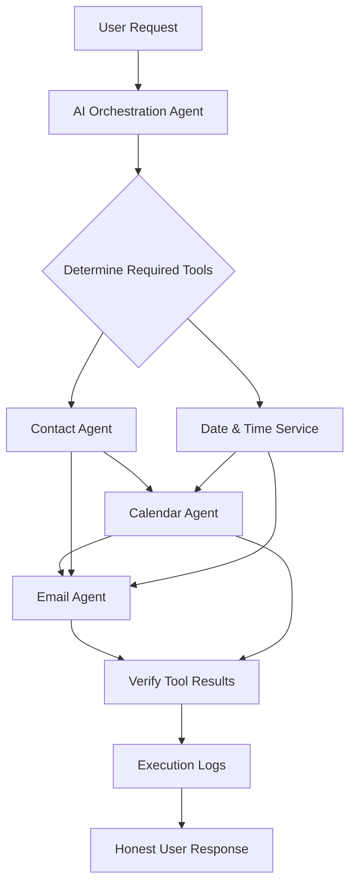

<div align="center">


# AI Personal Assistant

### Smarter Conversations. Real Actions.

An autonomous, multi-agent personal assistant designed to coordinate contacts, email, and calendar tasks through connected tools and verified workflows.

<p>
  
  
  
  
</p>

**Your Tasks • Our AI • Done Automatically**

</div>

---

## ✨ Overview

AI Personal Assistant is a tool-driven automation project that interprets natural-language requests, chooses the appropriate agents, executes multi-step workflows, and reports verified outcomes.

The project is designed around one core principle:

> **Understand the request. Execute the right workflow. Verify the result. Report honestly.**

### What it can do

- **Intelligent orchestration** — decide which agents and tools a request requires.
- **Contact management** — find recipient details before emails or meeting invitations.
- **Email automation** — send messages, create drafts, reply, and send confirmations through connected services.
- **Calendar management** — create, retrieve, update, and delete events.
- **Date and time handling** — resolve relative dates and apply the configured time zone.
- **Execution verification** — check operation results before reporting success.
- **Error handling** — detect failures, retry recoverable operations, and report blockers.
- **Logging and analytics** — record workflow status and relevant execution metadata.

> **Implementation note:** This README describes the intended project design. Actual capabilities depend on the workflows, integrations, credentials, and tools configured in your deployment.

---

## 🧠 Architecture



The orchestrator should invoke only the tools needed for the request. For dependent operations, it must pass verified results—such as an attendee email or calendar event ID—to the next agent.

## 🧩 Core Agents

| Agent / Service | Responsibilities |
|---|---|
| **AI Orchestrator** | Understand requests, choose tools, coordinate steps, and handle results |
| **Contact Agent** | Search available contacts and retrieve recipient details |
| **Calendar Agent** | Retrieve, create, update, and delete calendar events |
| **Email Agent** | Send emails, create drafts, reply, and send confirmations |
| **Date & Time Service** | Resolve dates, times, and time-zone context |
| **Logging Layer** | Track execution IDs, statuses, errors, and operation results |

## 🔁 Example: Schedule a Meeting and Email the Attendee

**User request**

> “Schedule a meeting with Ahmad today at 6 PM and email him the confirmation.”

**Expected workflow**

1. **Contact Agent** — find Ahmad and retrieve the email address from authorized contacts.
2. **Date & Time Service** — resolve “today” using the actual current date and configured time zone.
3. **Calendar Agent** — create the event and invite the verified attendee.
4. **Email Agent** — send a confirmation using the verified address and confirmed event details.
5. **Verification** — check the calendar and email results before reporting the outcome.

The workflow must not claim a meeting was booked unless the calendar operation succeeds. Invitation delivery does not mean the attendee has accepted the invitation.

## 🛡️ Reliability & Safety

- **Contact first:** never guess a recipient's email address.
- **Correct event targeting:** retrieve existing events before updating or deleting them.
- **Explicit start and end:** validate that event start precedes event end.
- **Notifications:** request attendee updates when supported and required.
- **No false success:** distinguish success, failure, and partial completion.
- **Safe recovery:** avoid deleting and recreating events as an automatic fallback unless explicitly authorized and carefully handled.
- **Minimal data exposure:** avoid logging credentials or unnecessary sensitive content.
- **Least privilege:** grant integrations only the permissions they need.
- **Approval policies:** require authorization for sensitive or destructive actions when configured.

## 🧰 Suggested Technology Stack

| Layer | Suggested technology |
|---|---|
| Workflow automation | [n8n](https://n8n.io/) |
| AI provider | [Groq](https://groq.com/) |
| Email integration | Gmail or another authorized email provider |
| Calendar integration | Google Calendar API |
| Contacts | Authorized contacts provider |
| Persistent execution logs | [PostgreSQL](https://www.postgresql.org/) |
| Credential management | n8n Credentials / OAuth or an approved secrets manager |

These are suggested components, not a claim that every integration is already connected.

## ⚙️ Setup

### 1. Prerequisites

- A running n8n instance.
- A Groq API key and a supported model configured in your AI node.
- Authorized email, calendar, and contacts integrations.
- PostgreSQL, if persistent workflow logging is enabled.

### 2. Configure credentials

Create credentials through the n8n credential manager for each provider. Configure the model, tool connections, calendar time zone, and any required permissions.

**Never commit API keys, OAuth tokens, passwords, or real `.env` secrets to GitHub.**

### 3. Connect the tools to the orchestrator

Make each agent's actual operations available as callable tools to the main AI Agent. Mentioning an agent in a system prompt does not connect the tool or grant permissions.

### 4. Test before production

Run controlled tests for contact lookup, email delivery, event creation, event updates, attendee notifications, and failure recovery. Verify results in the connected services.

## 🧪 Validation Checklist

- [ ] Contact lookup returns the intended person.
- [ ] Ambiguous contacts are handled safely.
- [ ] Emails use verified recipient addresses.
- [ ] Calendar events contain correct start and end times.
- [ ] Time zones are handled correctly.
- [ ] Attendee notifications are requested where appropriate.
- [ ] Event updates target the correct event ID.
- [ ] Failed updates do not trigger unintended deletions.
- [ ] Email confirmations reflect the actual calendar result.
- [ ] Tool errors and partial completion are reported accurately.
- [ ] Secrets are not exposed in logs or source control.

## 🗂️ Suggested Repository Layout

```text
ai-personal-assistant/
├── README.md
├── assets/
│   └── ai-personal-assistant-banner.png
├── docs/
│   ├── architecture.md
│   ├── setup.md
│   ├── workflows.md
│   └── troubleshooting.md
├── workflows/
│   ├── personal-assistant.json
│   ├── contact-agent.json
│   ├── calendar-agent.json
│   └── email-agent.json
├── database/
│   └── schema.sql
└── tests/
    └── validation-checklist.md
```

This is a recommended structure. Add workflow exports and other files only when they exist and are ready to share.

## 🗺️ Roadmap

- [ ] Finalize orchestration and agent-routing rules.
- [ ] Connect and validate the Contact Agent.
- [ ] Connect and validate the Calendar Agent.
- [ ] Connect and validate the Email Agent.
- [ ] Add persistent execution logging.
- [ ] Implement retries and error notifications.
- [ ] Add workflow monitoring and analytics.
- [ ] Add voice interaction and persistent user preferences.
- [ ] Document deployment, backups, and recovery.

## 🤝 Contributing

1. Fork the repository.
2. Create a feature branch.
3. Make focused changes and add tests where appropriate.
4. Document any new environment variables or credentials without publishing their values.
5. Submit a pull request with a clear summary and test results.

## 🔐 Security

Please do not publish credentials, private contact information, access tokens, or sensitive workflow execution data in issues or pull requests. Report security vulnerabilities privately to the project maintainer.

## 📄 License

No license has been specified yet. Add a `LICENSE` file before presenting this project as open source.

---

<div align="center">

### Work Smarter with AI.

**Understand • Automate • Verify**

</div>
"# AI-Workflow-Agent-Suite" 
